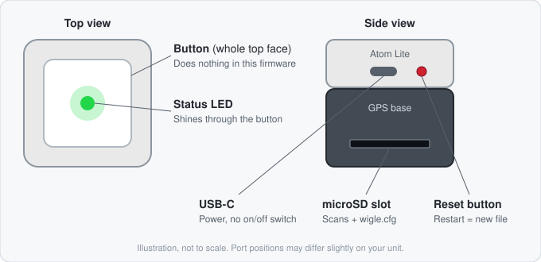

# AtomGPS Wigler

## Overview
AtomGPS_wigler is a wardriving tool initially **created by @lozaning** using the M5Stack Atom GPS kit. It's designed for Wi-Fi network scanning with LED status indicators.
Major code work by **@lukeswitzer**

## Prerequisites
- M5Stack Atom GPS Kit (available at [DigiKey](https://www.digikey.com/en/products/detail/m5stack-technology-co-ltd/K043/13148796) and elsewhere)
- TF Card (4GB standard, tested up to 32GB)
- ESPtool or Arduino IDE

## Installation
Clone the repository:
```bash
git clone https://github.com/lozaning/AtomGPS_wigler.git
```

## Flashing Instructions

### Method 1: Arduino IDE
- Dependencies:
      - esp32 boards and the M5Atom library. [Installation Docs](https://docs.espressif.com/projects/arduino-esp32/en/latest/installing.html). 
- Open the .ino file in the IDE
- Set Board: esp32 > M5Stack-Core-ESP32
- Select your device port from the dropdown and press Upload/Flash

### Method 2: Esptool
- Identify your device's port:
   - On Linux/macOS:
  ```bash
  ls /dev/ttyUSB*
  # or 
  ls /dev/cu.*
  ```
   - On Windows, check COM port in Device Manager.

- Flash the firmware .bin version of your choice: 
```bash
esptool.py --chip auto --port [PORT] erase_flash write_flash -z 0x1000 [FIRMWARE_FILE]
```
Replace `[PORT]` with your device's port and `[FIRMWARE_FILE]` with the firmware file.
You may need to execute the erase_flash and write_flash steps separately.

## User manual

### The device



- **Top button with LED:** you press the whole top face. The status LED sits underneath it. The button does nothing in this firmware.
- **Reset button** (small, on the side): restarts the device. A restart always begins a new CSV file.
- **USB-C:** power. Use a power bank or a car USB port. There is no on/off switch: plug it in to turn it on, unplug it to turn it off.
- **microSD slot:** holds the card that stores the scans and the config file. Use a FAT32 card up to 32 GB.

### Daily use

1. Put the microSD card in the slot.
2. Plug in power. Keep the device where it can see the sky, for example on the dashboard.
3. Wait for the purple blinking to stop. The first GPS fix can take a few minutes. It won't work indoors.
4. Drive or walk around. A short green blink means one scan round. A scan round takes about 2 seconds.
5. Unplug when you're done. Every network is saved the moment it's found, so unplugging is safe.

### LED colours

The icons below blink at the device's real speed.

| LED | Pattern | Meaning | What to do |
|:---:|---------|---------|------------|
|  | Fast purple blink | Started, waiting for the first GPS fix | Go outside, wait |
|  | Slow purple blink (1 s) | GPS fix lost | Get a clear view of the sky |
|  | Short green blink, repeating | Scanning and logging | Nothing |
|  | Solid blue | Connected to your Wi-Fi, uploading to WiGLE | Wait, don't unplug |
|  | Red blinking for 5 s right after power-on | SD card missing or unreadable. The device stays purple afterwards and records nothing. | Check the card, then press reset |
|  | One red flash per scan | Writing to the SD card failed | Check or replace the card |
|  | Off | Between blinks, or no power | Check the USB cable |

### Files on the SD card

| File | What it is |
|------|------------|
| `wifi-scans-YYYY-MM-DD-N.csv` | Your scans, in WiGLE format. The date is in UTC and `N` counts up with each start. |
| `wigle.cfg` | Settings for auto-upload. The device creates it on first start. |
| `uploaded/` | Scans that are already uploaded to WiGLE are moved here. |

You can always upload the CSV files yourself at [wigle.net/uploads](https://wigle.net/uploads).

### Auto-upload to WiGLE
On first boot the device creates a template `wigle.cfg` and an empty `uploaded/` folder in the root of the SD card. Put the card in a computer and fill in the template:
```
# up to 10 networks; each pass= belongs to the ssid= above it, blank ssid= lines are ignored
ssid=HomeWifi
pass=secret
ssid=WorkWifi
pass=other-secret
# "Encoded for use" token from https://wigle.net/account
wigle_auth=QUlE...
# optional: allow commercial use of your uploads
donate=off
```
When one of these networks is in range (at boot, or during scanning), the device connects and uploads every `wifi-scans-*.csv` that has data, then moves it to `/uploaded/`. Failed uploads are retried every 10 minutes while the network stays in range. After a successful upload it won't upload again until it has left the network's range and come back.

Notes:
- For an open network, leave `pass=` empty.
- Don't put quotes around values. Spaces are fine: `ssid=Rutger's iPhone`. Quotes would become part of the name.
- The network name must match exactly, including capitals and punctuation. iPhone hotspots often use a curly apostrophe (`’`), not a straight one (`'`). Copy the name from Settings > General > About > Name, and save the file as UTF-8.
- The device only reads `wigle.cfg` at start-up. Press reset after you change it.
- If `wigle_auth=` is empty, auto-upload is off.
